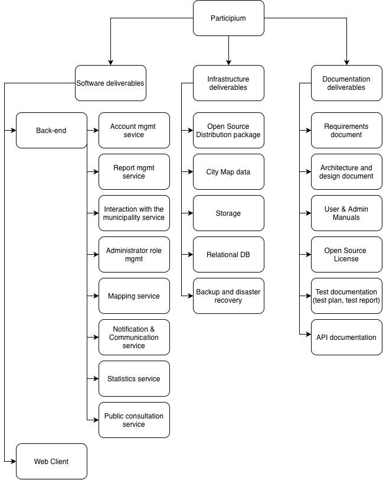
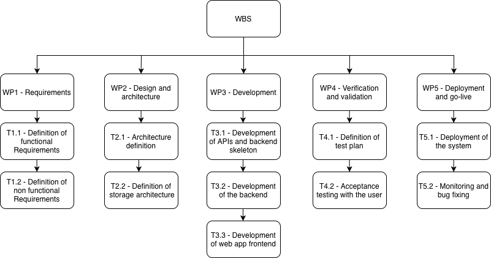
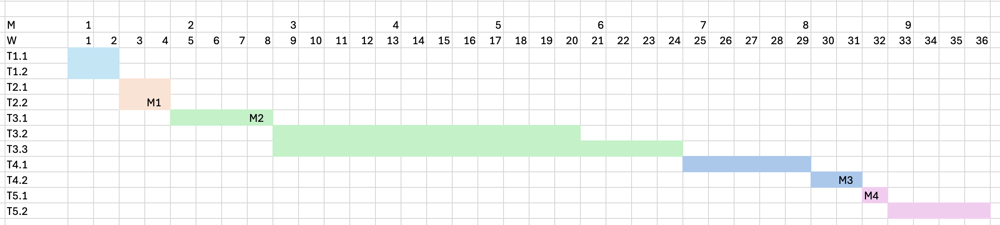

# Product Breakdown Structure (PBS)

| ID | Deliverable | Type  | Notes |
|:---|:------------|:--------------------------------------------------|:------|
| S1 | Account management service | Software | Handles user registration, authentication, profile management and roles (citizens, admins) |
| S2 | Report management service | Software | Core service for creating, editing, tracking and resolving reports submitted by users |
| S3 | Interaction with the municipality service | Software |Interface layer/API integration with municipal systems for report handling and status updates |
| S4 | Administration role management | Software | Tools for administrators to manage users, permissions, moderation and system configuration|
| S5 | Mapping service | Software | Provides geolocation features, map visualization and spatial association of reports |
| S6 | Notification and communication service | Software |Manages notifications (email/app) and communication between users and municipality |
| S7 | Statistics service | Software |Aggregates and analyzes data (reports, usage) to generate dashboards and insights |
| S8 | Public consultation service | Software | Enables visitor citizens just to check for new reports without interacting with them.| 
| S9 | Web client | Software | Frontend interface for users and administrators to access all system functionalities|
| I1 | City map data | Infrastructure |External geospatial dataset used by the mapping service (e.g., OpenStreetMap or municipal GIS) |
| I2 | Storage (reports) | Infrastructure |File/object storage for attachments (images, documents) associated with reports |
| I3 | Relational DB (Account, notification, Reports, Messaging) | Infrastructure |Central database storing structured data for all core services |
| I4 | Backup and disaster recovery | Infrastructure | Mechanisms ensuring data persistence, recovery and system continuity in case of failures| 
| D1 | Requirements document | Documentation |Defines functional, non-functional and domain requirements of the system |
| D2 | Architecture and design document | Documentation | Describes system architecture, components, interfaces and design decisions|
| D3 | Test documentation (Test plan, test report) | Documentation | Defines testing strategy, test cases and validation results |
| D4 | User manual and documentation | Documentation |Guides end users and administrators in using the platform |
| D5 | API documentation | Documentation |Describes interfaces exposed by services for integration and usage |
| D6 | Open source license | Documentation |Specifies licensing model and usage rights of the system (non-functional constraint) |

---

# Work Breakdown Structure (WBS)

### WBS with traceability to PBS
| ID  | Work package | Subtask |  Traced PBS outputs (IDs) |
|:----|:-------------|:--------------------------|:----------|
| T1.1 | Requirements | Definition of functional requirements | D1 |
| T1.2 | Requirements | Definition of non functional requirements | D1 |
| T2.1 | Design and architecture | Architecture definition |  D2  |
| T2.2 | Design and architecture | Definition of storage architecture | D1 |
| T3.1 | Development | Development of APIs and backend skeleton | I1, I2, I3, I4, S1, S2, S3, S4, S5, S6, S7, S8 |
| T3.2 | Development | Development of backend | I1, I2, I3, I4, S1, S2, S3, S4, S5, S6, S7, S8 |
| T3.3 | Development | Development of web app frontend | S9 |
| T4.1 | Verification and validation | Definition of test plan | D3 |
| T4.2 | Verification and validation | Acceptance testing with the user | D3 |
| T5.1 | Deployment and go-live | Deployment of the system | D4, D5, D6 |
| T5.2 | Deployment and go-live | Monitoring and bug fixing | D4, D5, D6 |

---

# Gantt, dependencies, and critical path

## Activity table
| ID | Activity | Duration | Dependencies | Start | End | Critical | Milestone |
|:---|:---------|:---------|:-------------|:------|:----|:------|:---------|
| T1.1 | Definition of functional requirement | 2 | - | 1 | 2 | yes | no |
| T1.2 | Definition of non functional requirement | 2 | - | 1 | 2 | yes | no |
| T2.1 | Architecture definition | 2 | T1.1, T2.2 | 3 | 4 | yes | no |
| T2.2 | Definition of storage architecture | 2 | T1.1, T1.2 |  3  |  4   |   yes    |     yes     |
| T3.1 | Development of APIs and backend skeleton | 4 | T2.1, T2.2| 5| 8 | yes | yes |
| T3.2 | Development of backend | 12 | T3.1| 9 | 20 | no | no |
| T3.3 | Development of web app frontend | 16 | T3.1| 9| 24| yes | no |
| T4.1 | Definition of test plan |5 | T3.1, T3.2, T3.3 | 25| 29| yes | no |
| T4.2 | Acceptance testing with the user | 2| T4.1|30 | 31| yes | yes |
| T5.1 | Deployment of the system | 1| T4.2| 32| 32| yes | yes |
| T5.2 | Monitoring and bug fixing | 4| T5.1| 33| 36| yes | no |

## Critical path
`T1.1 | T1.2 → T2.1 | T2.2 → T3.1 → T3.2 | T3.3 → T4.1 → T4.2 → T5.1 → T5.2`

Minimum duration of the activities in the GANTT Diagram: 36 weeks.

---

# Risk Management

**Scales and thresholds**
- **Probability (P)**: 1 (rare) … 5 (almost certain)
- **Impact (I)**: 1 (minor) … 5 (critical)
- **Exposure**: `P × I` (range 1–25)

Risk level thresholds (by exposure):
- **Low**: 1–5
- **Medium**: 6–10
- **High**: 11–16
- **Very High**: >16

## Risks table
| ID | Risk | Category | P | I | P×I | Level | Mitigation / Response strategy |
|:---|:-----|:---------|--:|--:|----:|:------|:-------------------------------|
| R1 | Scalabity and latency issues | Technical | 3  | 4  |  12   | High | Load Management                                |
| R2 | Storage issues causing loss of data | Technical | 2 | 5 | 10 | Medium | Mirroring and backup |
| R3 | API changes in OpenStreetMap | Technical | 3 | 4 | 12 | High | Abstraction layer for map APIs, fallback provider if needed |
| R4 | Security vulnerabilities exposing user data | Technical | 2 | 5 | 10 | medium | Apply secure authentication, input validation, encryption |
| R5 | Spam and fake reports | Technical | 4 | 3 | 12 | High | Security measure that distinguishes humans from bots, reporting/flagging mechanism |
| R6 | Failure of external communication services | Technical | 2 | 2 | 4 | Low | Fallback email provider |
| R7 | Interaction issues between system modules | Technical | 3 | 5 | 15 | High | Modular architecture, reduce redundant dependability between modules, integration testing |
| R8 | Bigger competitor enters the scene | Business | 1 | 5 | 5 | Low | Market analysis by external experts |
| R9 | Low citizen adoption due to lack of digital skills | Business | 1 | 5 | 5|Low | Promote platform campaigns and provide tutorials |
| R10 | Services costs increase | Business | 3 | 3 | 9 | Medium | Consider cheaper alternatives |
| R11 | Poor coordination between team members | Project | 2 | 4 | 8 | Medium | Clear task allocation, weekly meetings |
| R12 | Lack of developer skills or experience | Project | 2 | 2 | 4 | Low | Provide training courses and documentation |
| R13 | Bad or incomplete requirements | Project | 3 | 4 | 12 | High | Requirements reviews |
| R14 | Developer's turnover | Project | 2 | 4 | 8 | Medium | Fast hiring processes |

