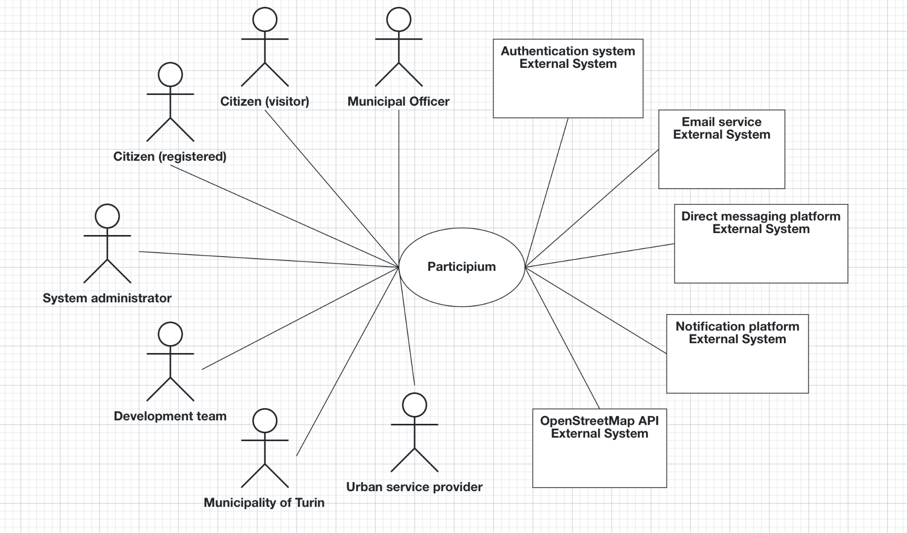

# 1) Stakeholders

| ID     | Stakeholder name | Description | Role | Main concerns |
|:-------|:-----------------|:------------|:-----|:--------------|
| STK-1 | Citizen (registered) | Registered citizens can submit reports, track their evolution, and interact with the municipality. They own a citizen account created by providing their identity information | User who can view and submit reports | Ease of use of the interfaces, privacy of personal data |
| STK-2 | Citizen (visitors) | Unregistered users who can access the public portal to browse reports, statistics, and map views without authentication | Public viewer | Accessibility of information, usability of navigation, transparency of data |
| STK-3 | Municipal office | Personnel of the municipality responsible for managing reports, including validation, assignment, operational handling, and communication with citizens | Internal system user managing reports|Efficient workflow management, ease of use, timely updates, clear communication with citizens |
| STK-4 | System administrator | Technical user responsible for configuring the system, managing users, and accessing advanced analytics and statistics | System manager | System reliability, security, access control, data integrity |
| STK-5 | OpenStreetMap API | External service providing map data and geolocation functionalities used to display and select report locations | External geolocation service | Availability, accuracy of map data, performance |
| STK-6 | Authentication system | External or integrated service that manages user authentication, registration, and identity verification | Identity provider | Security, privacy, authentication reliability |
| STK-7 | Notification platform | Component responsible for generating and delivering in-platform notifications related to report updates | Notification service | Timeliness, reliability, correct delivery of notifications |
| STK-8 | Email service | External service used to send email notifications to users who opted for them | Communication service | Deliverability, latency, spam filtering issues |
| STK-9 | Direct messaging platform | Internal system enabling communication between citizens and operators through messages | Communication channel | Message reliability, usability, data privacy |
| STK-10 | Advertisers | External entities potentially interested in placing advertisements within the platform (if supported) | Business stakeholder | Visibility, targeting effectiveness, user engagement |
| STK-11 | Development team | Group responsible for designing, implementing, maintaining, and evolving the Participium system | System builder and maintainer | Code quality, maintainability, scalability, requirement clarity |
| STK-12 | Municipality of Turin | Public authority for which the system is developed | Commisioner | Transparency, public trust, efficiency of urban issue resolution |
| STK-13 | Urban service providers | external companies or municipal contractors responsible for physically resolving reported issues (e.g., maintenance, repairs) | Service executor | Clear task assignment, timely communication, operational efficiency |

---

# 2) Context Diagram

Attach your context diagram as an image under `../data/img/` and link it here:

---

# 3) Interfaces

| ID    | Interface | Actor       | Physical interface | Logical interface |
|:------|:----------|:------------|:-------------------|:------------------|
| IF-1 | | Citizen (registered) | Smartphone/PC with internet connection | Web GUI |  
| IF-2 | | Citizen (visitor) | Smartphone/PC with internet connection | Web GUI |  
| IF-3 | | Municipal office | Smartphone/PC with internet connection | Web GUI |  
| IF-4 | | System administrator | Smartphone/PC with internet connection | Web GUI |  
| IF-5 | | OpenStreetMap API | Internet connection | Map APIs |  
| IF-6 | | Authetication system | Internet connection | Authentication APIs |  
| IF-7 | | Notification platform | Internet connection | Notification APIs |  
| IF-8 | | Email service | Internet connection | Email APIs |  
| IF-9 | | Direct messaging platform | Internet connection | Messaging APIs |  
| IF-10 | | Advertiser |  |  |  
| IF-11 | | Development team | Smartphone/PC with internet connection | Development and Web GUIs |  
| IF-12 | | Municipality of Turin | Smartphone/PC with internet connection | Web GUI |
| IF-13 | | Urban service providers | Smartphone on site |  |    

---

# 4) Personas

| ID     | Name | Role | Background / Context | Goals | Constraints | Devices / Usage setting | Accessibility / Additional needs |
|:-------|:-----|:-----|:---------------------|:------|:------------|:------------------------|:---------------------------------|
| PER-1 | Jack | Registered citizen | Citizen of Turin who usually goes to work by car and uses Participium every morning to report and visualize the reports | Avoid traffic disruptions and contribute to improving city service | Limited time due to work; cannot spend much time creating detailed reports | Mostly his smartphone, sometimes his PC | Clear and minimal GUI, simple to use with his smartphone |
| PER-2 | John | Visitor citizen | Non resident student of Turin who once per week uses car sharing to reach places in Turin far from his home and uses Participium not to be stuck in the traffic | Avoid traffic disruptions | Passive user | Smartphone | Clear and minimal GUI, simple to use with his smartphone |
| PER-3 | Mary | Municipal officer | She works for the municipality of Turin and her role is to check submitted reports and update their status | Maintaining reports quality and contributing to improve the city service | Time loss in deleting fake reports and in making the bad written ones useful | PC workstation | Automatization of report validation |
| PER-4 | Lian | System administrator | Technical member of the administration team who works in the security department | Guarantee user data protection and integrity | Must comply with GDPR internal privacy policies and must quickly respond to data integrity incidents | PC workstation | Secure authentication service and clear GDPR documentation | 
| PER-5 | Zhuri | Advertiser | Marketing professional working for an external advertising company | Reach the target audience and promote its services within the app | Must follow platform rules and guidelines | PC and mobile web | Access to clear advertising interface |
| PER-6 | Lucy | Development team member | Software engineer in charge of implementing new features and maintaining Participium | Deliver reliabke and maintainable system updates | Must follow coding standards | PC workstation and IDE | Access to development tools and documetation |
| PER-7 | Frank | Municipality of Turin employee | Administrative staff responsible for ensuring policies are applied | Proper handling of urban issues | Limited technical skills | PC workstation | User-friendly GUI and tutorials |
| PER-8 | Alex | Urban service provider | Technician performing maintainance and repairs based on reports received to Participium | Resolve reported urban issues efficiently and on time | Dependent on assignment scheduling and limited access to internal system | Smartphone on site | Mobile friendly GUI with clear task instructions and location info |
---

# 5) User Stories

| ID    | Persona/Role | User story (As a… I want… so that…) |
|:------|:-------------|:------------------------------------|
| US-1 | Registered citizen | As a registered citizen, I want to create an account on Participium so that I can access the platform |
| US-2 | Registered citizen | As a registered citizen, I want to be able to upload a new report on the platform with all the daitails I consider useful suck as photos, location and category |
| US-3 | Registered citizen | As a registered citizen, I want to be able to upload my reports with anonymity option |
| US-4 | Registered/visitor citizen | As a citizen, I want to check the reports in my city and their status so that I can be informed about issues in my area |
| US-5 | Registered/visitor citizen | As a citizen, I want to find records based on category filters |
| US-6 | Registered/visitor citizen | As a citizen, I want to find reports by using the map or the table view |
| US-7 | Registered/visitor citizen | As a citizen, I want to export the table view in a CSV format |
| US-8 | Registered/visitor citizen | As a citizen, I want to receive notifications about the uploading of new reports or about messages from municipality officers |
| US-9 | Registered/visitor citizen | As a citizen, I want to receive emails about the uploading of new reports or about messages from municipality officers |
| US-10 | Registered/visitor citizen | As a citizen, I want to check public statistics |
| US-11 | Registered/visitor citizen | As a citizen, I want to communicate with municipality officers |
| US-12 | Municipal officer | As a municipal officer, I want to access the platform with special permissions on reports |
| US-13 | Municipal officer | As a municipal officer, I want to check reports and be able to update/delete them |
| US-14 | Municipal officer | As a municipal officer, I want to communicate with citizens |
| US-15 | System administrator | As a system administrator, I want to manage the access to the platform through special permissions |
| US-16 | System administrator | As a system administrator, I want to guaratee the security on user data |
| US-17 | System administrator | As a system administrator, I want to access private statistics so that I can monitor system usage and report trends |
| US-18 | Advertiser | As an advertiser, I want to submit advertisment content to the platform so that it can be displayed to relevat users |
| US-19 | Advertiser | As an advertiser, I want to communicate with system administrators to measure the effectiveness of my ads |
| US-20 | Development team | As a development team member, I want to implement new features according to requirements so that the system meets user needs |
| US-21 | Development team | As a development team member, I want to maintain and update the codebase to improve maintainability and scalability |
| US-22 | Municipality of Turin | As a municipality of Turin member, I want to track the effectivenss of the platform so that I can be sure it is useful for the citizens |
| US-23 | Urban service provider | As a urban service provider, I want to receive assignement tasks with the location so that I can resolve reported urban issues efficiently |
| US-24 | Urban service provider | As a urban service provider, I want to refer to municipal officers via platform the new status of the tasks |

---

# 6) Functional Requirements (FR)

| ID    | Requirement statement (The system shall…) | Priority | User story ID | Notes |
|:------|:------------------------------------------|:---------|:--------------|:------|
| FR-XX |                                           |          |               |       |

---

# 7) Non-Functional Requirements (NFR)

| ID     | Category | Requirement statement | Metric / Target | Verification                           | Priority | Notes |
|:-------|:---------|:----------------------|:----------------|:---------------------------------------|:---------|:------|
| NFR-XX |          |                       |                 |                                        |          |       |