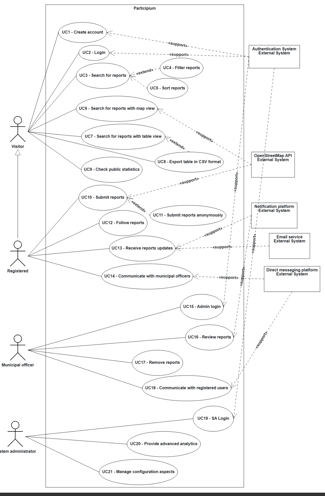

# 1) Use Case Diagram

Attach your use case diagram as an image under `../data/img/` and link it here:

Also, make sure to include the JSON source file downloaded from the UML Modeler used to draw the diagram in the `../data/` folder.

# 2) Use Case Narratives

Add one narrative for each use case shown in the diagram.
  
| Use Case                | Create account                                  |
|:------------------------|:------------------------------------------------|
| ID                      | UC1                                             |
| Scope                   | Participium                                     |
| Level                   | User-Goal                                       |
| Intention in Context    | The visitor wants to register in the system     |
| Primary actor           | Visitor                                         |
| Supporting actors       | Authentication System                           |
| Stakeholders' interests | Platform managers: ensuring valid user accounts |
| Precondition            | -                                               |
| Minimum guarantees      | -                                               |
| Success guarantees      | The account is created for the user             |
| Trigger                 | -                                               |
| Main success scenario   | 1. The visitor asks to create an account        |
|                         | 2. The system shows the registration form       |
|                         | 3. The visitor inserts username, first name,    |
|                         |    last name, e-mail and password               |
|                         | 4. The system validates the inserted data       |
|                         | 5. The system sends the registration request    |
|                         |    to the authentication system                 |
|                         | 6. The authentication system sends a            |
|                         |    verification link to the user                |
|                         | 7. The user opens the verification link         |
|                         | 8. The system confirms the registration and     |
|                         |    creates the account                          |
| Extensions              | 4a.1 Some inserted data are invalid or          |
|                         |      incomplete                                 |
|                         | 4a.2 The system shows an error and asks for     |
|                         |      correction                                 |
|                         | 4b.1 The username is already registered         |
|                         | 4b.2 The system shows an error and the use case |
|                         |      goes back to step 2                        |
|                         | 7a.1 The verification fails                     |
|                         | 7a.2 The account is not activated. Use case     |
|                         |      fails                                      |

| Use Case                | Login                                           |
|:------------------------|:------------------------------------------------|
| ID                      | UC2                                             |
| Scope                   | Participium                                     |
| Level                   | User Goal                                       |
| Intention in Context    | The visitor wants to log in the system          |
| Primary actor           | Visitor                                         |
| Supporting actors       | Authentication System                           |
| Stakeholders' interests | -                                               |
| Precondition            | The user has an account                         |
| Minimum guarantees      | -                                               |
| Success guarantees      | The user is logged in the system                |
| Trigger                 | -                                               |
| Main success scenario   | 1. The visitor asks to login                    |
|                         | 2. The system shows the form for credentials    |
|                         | 3. The visitor inserts username and password    |
|                         | 4. The system validates the credentials through |
|                         |    the authentication system                    |
|                         | 5. The system logs the user in                  |
| Extensions              | 4a.1 Invalid username or password               |
|                         | 4a.2 The system shows an error and the use case |
|                         |      goes to step 2                             |

| Use Case                | Search for reports                              |
|:------------------------|:------------------------------------------------|
| ID                      | UC3                                             |
| Scope                   | Participium                                     |
| Level                   | User Goal                                       |
| Intention in Context    | The visitor wants to search for public reports  |
|                         | in the system                                   |
| Primary actor           | Visitor                                         |
| Supporting actors       | -                                               |
| Stakeholders' interests | Visitors: finding public reports easily         |
| Precondition            | -                                               |
| Minimum guarantees      | Private data are not shown                      |
| Success guarantees      | The searched reports are shown to the user      |
| Trigger                 | -                                               |
| Main success scenario   | 1. The visitor enters a search query            |
|                         | 2. The system shows the reports corresponding   |
|                         |    to the query                                 |
|                         | 3. The visitor selects a report                 |
|                         | 4. The system shows the report details          |
| Extensions              | 2a.1 No reports are found with the search query |
|                         | 2a.2 The system informs the visitor that no     |
|                         |      results are available                      |

| Use Case                | Filter reports                                  |
|:------------------------|:------------------------------------------------|
| ID                      | UC4                                             |
| Scope                   | Participium                                     |
| Level                   | User Goal                                       |
| Intention in Context    | The visitor wants to apply filters to the       |
|                         | displayed reports                               |
| Primary actor           | Visitor                                         |
| Supporting actors       | -                                               |
| Stakeholders' interests | Visitors: obtaining more specific search        |
|                         | results                                         |
| Precondition            | Reports are already shown in the system         |
| Minimum guarantees      | -                                               |
| Success guarantees      | The filtered reports are shown to the user      |
| Trigger                 | -                                               |
| Main success scenario   | 1. The visitor selects one or more filters      |
|                         | 2. The system applies the selected filters      |
|                         | 3. The system shows the filtered reports        |
|                         | 4. The visitor selects a report                 |
|                         | 5. The system shows the report details          |
| Extensions              | 2a.1 No reports match the selected filters      |
|                         | 2a.2 The system informs the visitor that no     |
|                         |      results are available                      |

| Use Case                | Sort reports                                    |
|:------------------------|:------------------------------------------------|
| ID                      | UC5                                             |
| Scope                   | Participium                                     |
| Level                   | User Goal                                       |
| Intention in Context    | The visitor wants to sort reports in a useful   |
|                         | order                                           |
| Primary actor           | Visitor                                         |
| Supporting actors       | -                                               |
| Stakeholders' interests | Visitors: viewing reports in a clearer way      |
| Precondition            | Reports are already shown in the system         |
| Minimum guarantees      | -                                               |
| Success guarantees      | The reports are shown in the selected order     |
| Trigger                 | -                                               |
| Main success scenario   | 1. The visitor selects a sorting criterion      |
|                         | 2. The system sorts the reports                 |
|                         | 3. The system shows the sorted results          |
|                         | 4. The visitor selects a report                 |
|                         | 5. The system shows the report details          |
| Extensions              | 2a.1 The selected sorting criterion is not      |
|                         |      valid                                      |
|                         | 2a.2 The system shows an error                  |

| Use Case                | Search for reports with map view                |
|:------------------------|:------------------------------------------------|
| ID                      | UC6                                             |
| Scope                   | Participium                                     |
| Level                   | User Goal                                       |
| Intention in Context    | The visitor wants to view reports on the city   |
|                         | map                                             |
| Primary actor           | Visitor                                         |
| Supporting actors       | OpenStreetMap API                               |
| Stakeholders' interests | Visitors: seeing where the issues are located   |
|                         | in the city                                     |
| Precondition            | Public reports with location exist in the       |
|                         | system                                          |
| Minimum guarantees      | Private data are not shown                      |
| Success guarantees      | The reports are shown on the map                |
| Trigger                 | -                                               |
| Main success scenario   | 1. The visitor asks to view reports on the map  |
|                         | 2. The system loads the city map through the    |
|                         |    OpenStreetMap API                            |
|                         | 3. The system shows the available reports on    |
|                         |    the map                                      |
|                         | 4. The visitor selects one report               |
|                         | 5. The system shows the report details          |
| Extensions              | 2a.1 The map cannot be loaded                   |
|                         | 2a.2 The system shows an error. Use case fails  |
|                         | 3a.1 No reports are available on the map        |
|                         | 3a.2 The system shows an empty map              |

| Use Case                | Search for reports with table view              |
|:------------------------|:------------------------------------------------|
| ID                      | UC7                                             |
| Scope                   | Participium                                     |
| Level                   | User Goal                                       |
| Intention in Context    | The visitor wants to view reports in table      |
|                         | format                                          |
| Primary actor           | Visitor                                         |
| Supporting actors       | -                                               |
| Stakeholders' interests | Visitors: viewing reports in a structured way   |
| Precondition            | Public reports exist in the system              |
| Minimum guarantees      | Private data are not shown                      |
| Success guarantees      | The reports are shown in table format           |
| Trigger                 | -                                               |
| Main success scenario   | 1. The visitor asks to view reports in table    |
|                         |    format                                       |
|                         | 2. The system retrieves the public reports      |
|                         | 3. The system shows the reports in a table      |
|                         | 4. The visitor selects a report                 |
|                         | 5. The system shows the report details          |
| Extensions              | 2a.1 No public reports are available            |
|                         | 2a.2 The system shows an empty table            |

| Use Case                | Export table in CSV format                      |
|:------------------------|:------------------------------------------------|
| ID                      | UC8                                             |
| Scope                   | Participium                                     |
| Level                   | User Goal                                       |
| Intention in Context    | The visitor wants to export table results in    |
|                         | CSV format                                      |
| Primary actor           | Visitor                                         |
| Supporting actors       | -                                               |
| Stakeholders' interests | Visitors: saving and reusing public data        |
| Precondition            | Reports are shown in table format               |
| Minimum guarantees      | Report data are not modified                    |
| Success guarantees      | A CSV file containing the shown reports is      |
|                         | generated                                       |
| Trigger                 | -                                               |
| Main success scenario   | 1. The visitor asks to export the table in CSV  |
|                         |    format                                       |
|                         | 2. The system prepares the CSV file from the    |
|                         |    displayed results                            |
|                         | 3. The system makes the file available for      |
|                         |    download                                     |
|                         | 4. The visitor downloads the file               |
| Extensions              | 2a.1 There are no results to export             |
|                         | 2a.2 The system informs the visitor that the    |
|                         |      export cannot be completed                 |

| Use Case                | Check public statistics                         |
|:------------------------|:------------------------------------------------|
| ID                      | UC9                                             |
| Scope                   | Participium                                     |
| Level                   | User Goal                                       |
| Intention in Context    | The visitor wants to view public statistics     |
|                         | about reports                                   |
| Primary actor           | Visitor                                         |
| Supporting actors       | -                                               |
| Stakeholders' interests | Visitors: accessing public information about    |
|                         | the reports                                     |
| Precondition            | Statistical data are available in the system    |
| Minimum guarantees      | Private data are not shown                      |
| Success guarantees      | Public statistics are shown to the user         |
| Trigger                 | -                                               |
| Main success scenario   | 1. The visitor asks to view public statistics   |
|                         | 2. The system shows the number of reports by    |
|                         |    category                                     |
|                         | 3. The system shows the trends over time        |
|                         | 4. The visitor consults the statistics          |
| Extensions              | 2a.1 Statistical data are not available         |
|                         | 2a.2 The system shows an error                  |

| Use Case                | Submit reports                                  |
|:------------------------|:------------------------------------------------|
| ID                      | UC10                                            |
| Scope                   | Participium                                     |
| Level                   | User Goal                                       |
| Intention in Context    | The registered user wants to submit a new       |
|                         | report about an urban issue                     |
| Primary actor           | Registered user                                 |
| Supporting actors       | OpenStreetMap API                               |
| Stakeholders' interests | Municipality: receiving valid and complete      |
|                         | reports from citizens                           |
| Precondition            | The user is logged in                           |
| Minimum guarantees      | Invalid reports are not saved in the system     |
| Success guarantees      | A new report is registered in the system with   |
|                         | its initial status                              |
| Trigger                 | -                                               |
| Main success scenario   | 1. The user asks to submit a new report         |
|                         | 2. The system shows the report form and the     |
|                         |    city map                                     |
|                         | 3. The user selects the issue location on the   |
|                         |    map                                          |
|                         | 4. The system stores the selected coordinates   |
|                         | 5. The user inserts title, description and      |
|                         |    category of the report                       |
|                         | 6. The user uploads one or more photos          |
|                         | 7. The system validates the inserted data       |
|                         | 8. The user confirms the submission             |
|                         | 9. The system saves the report with initial     |
|                         |    status and shows a confirmation              |
| Extensions              | 3a.1 The location is not selected               |
|                         | 3a.2 The system shows an error and asks the     |
|                         |      user to select a location                  |
|                         | 6a.1 More than 3 photos are uploaded            |
|                         | 6a.2 The system shows an error and asks the     |
|                         |      user to remove extra photos                |
|                         | 7a.1 The report data are incomplete or invalid  |
|                         | 7a.2 The system shows an error and asks for     |
|                         |      correction                                 |

| Use Case                | Submit reports anonymously                      |
|:------------------------|:------------------------------------------------|
| ID                      | UC11                                            |
| Scope                   | Participium                                     |
| Level                   | User Goal                                       |
| Intention in Context    | The registered user wants to submit a report    |
|                         | without showing their identity publicly         |
| Primary actor           | Registered user                                 |
| Supporting actors       | -                                               |
| Stakeholders' interests | Users: reporting issues while preserving        |
|                         | public anonymity                                |
| Precondition            | The user is logged in and is submitting a       |
|                         | report                                          |
| Minimum guarantees      | The report is not published with invalid        |
|                         | anonymity settings                              |
| Success guarantees      | The report is stored and the reporter identity  |
|                         | is hidden in public views                       |
| Trigger                 | -                                               |
| Main success scenario   | 1. The user starts the submission of a new      |
|                         |    report                                       |
|                         | 2. The system shows the report form             |
|                         | 3. The user selects the anonymous submission    |
|                         |    option                                       |
|                         | 4. The user inserts the required report data    |
|                         |    and confirms                                 |
|                         | 5. The system saves the report and marks it as  |
|                         |    anonymous for public views                   |
| Extensions              | 4a.1 The report data are incomplete or invalid  |
|                         | 4a.2 The system shows an error and asks for     |
|                         |      correction                                 |

| Use Case                | Follow reports                                  |
|:------------------------|:------------------------------------------------|
| ID                      | UC12                                            |
| Scope                   | Participium                                     |
| Level                   | User Goal                                       |
| Intention in Context    | The registered user wants to follow a report    |
|                         | to receive updates about it                     |
| Primary actor           | Registered user                                 |
| Supporting actors       | -                                               |
| Stakeholders' interests | Users: being informed about the evolution of a  |
|                         | report                                          |
| Precondition            | The user is logged in and a report exists in    |
|                         | the system                                      |
| Minimum guarantees      | -                                               |
| Success guarantees      | The follow is registered in the system          |
| Trigger                 | -                                               |
| Main success scenario   | 1. The user opens the details of a report       |
|                         | 2. The user asks to follow the report           |
|                         | 3. The system registers the follow for that     |
|                         |    user                                         |
|                         | 4. The system confirms the operation            |
| Extensions              | 3a.1 The user is already following the report   |
|                         | 3a.2 The system informs the user that the       |
|                         |      follow already exists                      |

| Use Case                | Receive reports updates                         |
|:------------------------|:------------------------------------------------|
| ID                      | UC13                                            |
| Scope                   | Participium                                     |
| Level                   | User Goal                                       |
| Intention in Context    | The user wants to receive updates when a        |
|                         | followed or owned report changes status         |
| Primary actor           | Registered user                                 |
| Supporting actors       | Notification platform, Email service            |
| Stakeholders' interests | Users: receiving clear updates about report     |
|                         | evolution                                       |
| Precondition            | The user follows the report or is the original  |
|                         | reporter                                        |
| Minimum guarantees      | An in-platform notification is generated        |
| Success guarantees      | The user receives the report update             |
| Trigger                 | A report changes status                         |
| Main success scenario   | 1. A report changes status in the system        |
|                         | 2. The system generates an in-platform          |
|                         |    notification for the reporter and followers  |
|                         | 3. The system checks whether email              |
|                         |    notifications are enabled                    |
|                         | 4. The system sends the update through the      |
|                         |    notification platform                        |
|                         | 5. The system sends the same update by email,   |
|                         |    if enabled                                   |
|                         | 6. The user receives the update                 |
| Extensions              | 5a.1 Email notifications are disabled           |
|                         | 5a.2 The system sends only the in-platform      |
|                         |      notification                               |
|                         | 5b.1 The email service is unavailable           |
|                         | 5b.2 The system sends only the in-platform      |
|                         |      notification                               |

| Use Case                | Communicate with municipal officers             |
|:------------------------|:------------------------------------------------|
| ID                      | UC14                                            |
| Scope                   | Participium                                     |
| Level                   | User Goal                                       |
| Intention in Context    | The registered user wants to communicate with   |
|                         | municipal officers about a report               |
| Primary actor           | Registered user                                 |
| Supporting actors       | Direct messaging platform                       |
| Stakeholders' interests | Users: receiving clarifications and updates     |
|                         | from the municipality                           |
| Precondition            | The user is logged in and a related report      |
|                         | exists                                          |
| Minimum guarantees      | Sent messages are not lost silently             |
| Success guarantees      | The message is delivered through the platform   |
| Trigger                 | -                                               |
| Main success scenario   | 1. The user opens the communication area        |
|                         |    related to a report                          |
|                         | 2. The system shows the message interface       |
|                         | 3. The user writes a message and sends it       |
|                         | 4. The system sends the message through the     |
|                         |    direct messaging platform                    |
|                         | 5. The system shows the updated conversation    |
| Extensions              | 4a.1 The messaging platform is unavailable      |
|                         | 4a.2 The system shows an error and the use      |
|                         |      case fails                                 |
|                         | 3a.1 The message is empty                       |
|                         | 3a.2 The system asks the user to insert valid   |
|                         |      text                                       |

| Use Case                | Admin login                                     |
|:------------------------|:------------------------------------------------|
| ID                      | UC15                                            |
| Scope                   | Participium                                     |
| Level                   | User Goal                                       |
| Intention in Context    | The municipal officer wants to log in the       |
|                         | system to access administrative functions       |
| Primary actor           | Municipal officer                               |
| Supporting actors       | Authentication System                           |
| Stakeholders' interests | Municipality: allowing access only to           |
|                         | authorized officers                             |
| Precondition            | The municipal officer has valid credentials     |
| Minimum guarantees      | Unauthorized access is not allowed              |
| Success guarantees      | The municipal officer is logged in the system   |
| Trigger                 | -                                               |
| Main success scenario   | 1. The municipal officer asks to login          |
|                         | 2. The system shows the credentials form        |
|                         | 3. The municipal officer inserts username and   |
|                         |    password                                     |
|                         | 4. The system validates the credentials         |
|                         |    through the authentication system            |
|                         | 5. The system logs the municipal officer in     |
| Extensions              | 4a.1 Invalid username or password               |
|                         | 4a.2 The system shows an error and the use      |
|                         |      case goes to step 2                        |

| Use Case                | Review reports                                  |
|:------------------------|:------------------------------------------------|
| ID                      | UC16                                            |
| Scope                   | Participium                                     |
| Level                   | User Goal                                       |
| Intention in Context    | The municipal officer wants to review a report  |
|                         | submitted by a citizen                          |
| Primary actor           | Municipal officer                               |
| Supporting actors       | Notification platform                           |
| Stakeholders' interests | Municipality: reviewing reports correctly       |
|                         | before handling them                            |
| Precondition            | The municipal officer is logged in and a report |
|                         | is available for review                         |
| Minimum guarantees      | The report remains stored in the system         |
| Success guarantees      | The report is reviewed and its status is        |
|                         | updated                                         |
| Trigger                 | report notification                             |
| Main success scenario   | 1. The municipal officer selects a report to    |
|                         |    review                                       |
|                         | 2. The system shows the report details          |
|                         | 3. The municipal officer analyzes the report    |
|                         |    and selects the new status                   |
|                         | 4. The system updates the report status         |
|                         | 5. The system generates an update notification  |
|                         |    for the reporter and followers               |
|                         | 6. The system confirms the operation to the     |
|                         |    municipal officer                            |
| Extensions              | 3a.1 The municipal officer decides to reject    |
|                         |      the report                                 |
|                         | 3a.2 The system asks for a rejection motivation |
|                         |      and updates the report as rejected         |
|                         | 4a.1 The selected status is not valid           |
|                         | 4a.2 The system shows an error and asks for     |
|                         |      correction                                 |

| Use Case                | Remove reports                                  |
|:------------------------|:------------------------------------------------|
| ID                      | UC17                                            |
| Scope                   | Participium                                     |
| Level                   | User Goal                                       |
| Intention in Context    | The municipal officer wants to remove a report  |
|                         | from the system                                 |
| Primary actor           | Municipal officer                               |
| Supporting actors       | -                                               |
| Stakeholders' interests | Municipality: removing invalid or inappropriate |
|                         | reports from the platform                       |
| Precondition            | The municipal officer is logged in and the      |
|                         | report exists                                   |
| Minimum guarantees      | No report is removed without confirmation       |
| Success guarantees      | The selected report is removed from the system  |
| Trigger                 | -                                               |
| Main success scenario   | 1. The municipal officer selects a report to    |
|                         |    remove                                       |
|                         | 2. The system shows the report details and asks |
|                         |    for confirmation                             |
|                         | 3. The municipal officer confirms the removal   |
|                         | 4. The system removes the report                |
|                         | 5. The system confirms the operation            |
| Extensions              | 3a.1 The municipal officer does not confirm     |
|                         |      the removal                                |
|                         | 3a.2 The use case ends with failure             |

| Use Case                | Communicate with registered users               |
|:------------------------|:------------------------------------------------|
| ID                      | UC18                                            |
| Scope                   | Participium                                     |
| Level                   | User Goal                                       |
| Intention in Context    | The municipal officer wants to communicate      |
|                         | with a registered user about a report           |
| Primary actor           | Municipal officer                               |
| Supporting actors       | Direct messaging platform                       |
| Stakeholders' interests | Municipality: providing clarifications and      |
|                         | updates to citizens                             |
| Precondition            | The municipal officer is logged in and a        |
|                         | related report exists                           |
| Minimum guarantees      | Sent messages are not lost silently             |
| Success guarantees      | The message is delivered through the platform   |
| Trigger                 | -                                               |
| Main success scenario   | 1. The municipal officer opens the              |
|                         |    communication area of a report               |
|                         | 2. The system shows the conversation interface  |
|                         | 3. The municipal officer writes a message       |
|                         |    and sends it                                 |
|                         | 4. The system sends the message through the     |
|                         |    direct messaging platform                    |
|                         | 5. The system shows the updated conversation    |
| Extensions              | 3a.1 The message is empty                       |
|                         | 3a.2 The system asks for a valid message        |
|                         | 4a.1 The messaging platform is unavailable      |
|                         | 4a.2 The system shows an error and the use      |
|                         |      case fails                                 |

| Use Case                | SA Login                                        |
|:------------------------|:------------------------------------------------|
| ID                      | UC19                                            |
| Scope                   | Participium                                     |
| Level                   | User Goal                                       |
| Intention in Context    | The system administrator wants to log in the    |
|                         | system                                          |
| Primary actor           | System administrator                            |
| Supporting actors       | Authentication System                           |
| Stakeholders' interests | Platform managers: allowing access only to      |
|                         | authorized administrators                       |
| Precondition            | The system administrator has valid credentials  |
| Minimum guarantees      | Unauthorized access is not allowed              |
| Success guarantees      | The system administrator is logged in           |
| Trigger                 | -                                               |
| Main success scenario   | 1. The system administrator asks to login       |
|                         | 2. The system shows the credentials form        |
|                         | 3. The system administrator inserts username    |
|                         |    and password                                 |
|                         | 4. The system validates the credentials through |
|                         |    the authentication system                    |
|                         | 5. The system administrator is logged in        |
| Extensions              | 4a.1 Invalid username or password               |
|                         | 4a.2 The system shows an error and the use      |
|                         |      case goes to step 2                        |

| Use Case                | Provide advanced analytics                      |
|:------------------------|:------------------------------------------------|
| ID                      | UC20                                            |
| Scope                   | Participium                                     |
| Level                   | User Goal                                       |
| Intention in Context    | The system administrator wants to view private  |
|                         | statistics and advanced analytics               |
| Primary actor           | System administrator                            |
| Supporting actors       | -                                               |
| Stakeholders' interests | Platform managers: accessing detailed internal  |
|                         | statistics about reports                        |
| Precondition            | The system administrator is logged in           |
| Minimum guarantees      | Public users cannot access private analytics    |
| Success guarantees      | Advanced analytics are shown to the             |
|                         | administrator                                   |
| Trigger                 | -                                               |
| Main success scenario   | 1. The system administrator asks to view        |
|                         |    advanced analytics                           |
|                         | 2. The system retrieves the private             |
|                         |    statistical data                             |
|                         | 3. The system shows statistics about reports by |
|                         |    status, type and reporter                    |
|                         | 4. The system shows more detailed aggregations, |
|                         |    including top reporters                      |
|                         | 5. The system administrator consults the        |
|                         |    analytics                                    |
| Extensions              | 2a.1 Private statistical data are not available |
|                         | 2a.2 The system shows an error                  |

| Use Case                | Manage configuration aspects                    |
|:------------------------|:------------------------------------------------|
| ID                      | UC21                                            |
| Scope                   | Participium                                     |
| Level                   | User Goal                                       |
| Intention in Context    | The system administrator wants to manage        |
|                         | configuration aspects of the platform           |
| Primary actor           | System administrator                            |
| Supporting actors       | -                                               |
| Stakeholders' interests | Platform managers: keeping the platform         |
|                         | correctly configured                            |
| Precondition            | The system administrator is logged in           |
| Minimum guarantees      | Invalid configuration changes are not saved     |
| Success guarantees      | The new configuration is saved in the system    |
| Trigger                 | -                                               |
| Main success scenario   | 1. The system administrator asks to manage      |
|                         |    configuration aspects                        |
|                         | 2. The system shows the available configuration |
|                         |    settings                                     |
|                         | 3. The system administrator changes one or more |
|                         |    settings                                     |
|                         | 4. The system validates the new configuration   |
|                         | 5. The system saves the configuration and       |
|                         |    confirms the operation                       |
| Extensions              | 4a.1 The new configuration is invalid           |
|                         | 4a.2 The system shows an error and asks for     |
|                         |      correction                                 |
# 3) Traceability Table

| UC ID | REQ ID |
| :---- | :----- |
| UC-1  | FR-1   | 
| UC-2  | FR-2   |
| UC-3  | FR-4   | 
| UC-4  | FR-4.1 | 
| UC-5  | FR-4.2 | 
| UC-6  | FR-4.3 | 
| UC-7  | FR-4.3 | 
| UC-8  | FR-6   |  
| UC-9  | FR-7   |
| UC-10 | FR-3   | 
| UC-11 | FR-3.5 | 
| UC-12 | FR-8.2 | 
| UC-13 | FR-5.1 | 
| UC-13 | FR-5.2 | 
| UC-14 | FR-5.3 | 
| UC-15 | FR-9   | 
| UC-16 | FR-9.1 | 
| UC-17 | FR-9.1 | 
| UC-18 | FR-9.2 | 
| UC-19 | FR-10  | 
| UC-20 | FR-10.1|
| UC-21 | FR-10.2| 

