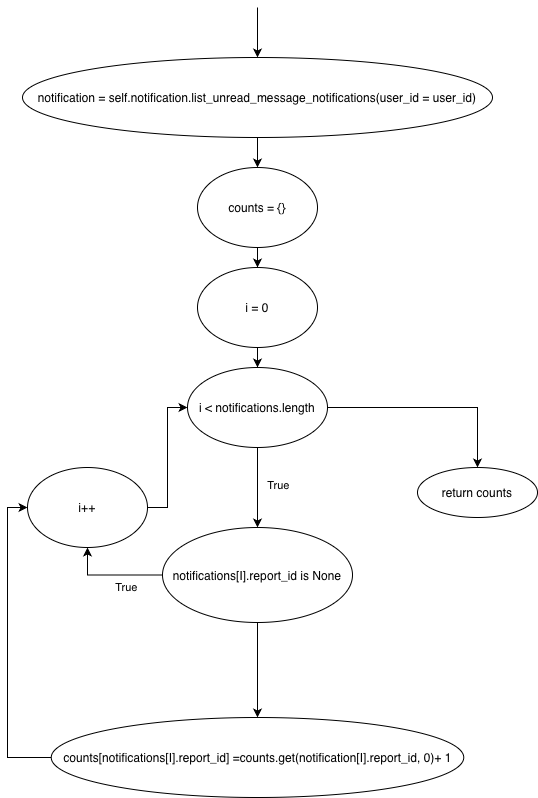

## 1 `ReportService.create_report`

### Control Flow Graph

- 

### Atomic Conditions

### Structural Lower Bound

### Node Coverage

### Edge Coverage

### Condition Coverage

### Loop Coverage

### Path Coverage

### Minimal Suite Test

## 2 `MessagingService._resolve_recipient`

### Control Flow Graph

- 

### Atomic Conditions

### Structural Lower Bound

### Node Coverage

### Edge Coverage

### Condition Coverage

### Loop Coverage

### Path Coverage

### Minimal Suite Test

## 3 `NotificationService.notify_status_change`

### Control Flow Graph  
 

### Atomic Conditions
- **C1**: `recipient is None`  
- **C2**: `recipient.id in seen`

### Structural Lower Bound
The structural lower bound is **3**. This value represents the minimum number of independent paths required to cover the loop termination and the two branches of the decision point (the `if` statement).

### Node Coverage
To achieve **100% Node Coverage**, the test suite must ensure that:
- The loop body is entered (**requires a non-empty list**).
- The `continue` statement is executed (**requires a `None` recipient or a duplicate ID**).
- The `seen.add()` and `create_notification()` methods are executed (**requires at least one valid, new recipient**).

### Edge Coverage
All transitions in the CFG must be traversed:
- **Loop Edges**: Traversing the path where the loop condition is **True** (entering the loop) and **False** (empty list or loop completion).
- **Decision Edges**: Traversing the **True branch** of the `if` (triggering `continue`) and the **False branch** (proceeding to notification creation).

### Condition Coverage
Each atomic condition must be evaluated as both **True** and **False**:
- **Test 1**: C1 is **True** (e.g., `recipient = None`) → triggers `continue`.
- **Test 2**: C1 is **False** and C2 is **True** (e.g., a duplicate `user.id`) → triggers `continue`.
- **Test 3**: Both C1 and C2 are **False** (e.g., a new, valid `User`) → triggers notification.

### Loop Coverage
The loop logic is verified through:
- **0 Iterations**: `recipients = []` (the loop is skipped entirely).
- **1 Iteration**: `recipients = [User(id=1)]` (the loop runs once).
- **Multiple Iterations**: `recipients = [User(id=102), User(id=103)]` (ensures the `seen` set persists correctly across iterations).

### Path Coverage
The following logical paths are tested:
- **Path A**: Start → Loop Condition **False** → End.
- **Path B**: Start → Loop Condition **True** → `if` **True** → `continue` → Next Iteration.
- **Path C**: Start → Loop Condition **True** → `if` **False** → `create_notification()` → Next Iteration.

### Minimal Suite Test
A total of **3 test cases** are sufficient to achieve maximum structural coverage:
- **Empty List**: `recipients = []`  
  Covers the 0-iteration loop path and the **False** edge of the loop condition.

- **Null Recipient**: `recipients = [None]`  
  Covers C1 = **True** and the execution of the `continue` node.

- **Duplicate Valid Users**: `recipients = [User(id=102), User(id=102)]`  
  - **Iteration 1**: Covers C1 = **False**, C2 = **False**, and the notification creation node.  
  - **Iteration 2**: Covers C1 = **False**, C2 = **True**, verifying the `seen` set logic and the **True** branch of the `if`.

## 4 `NotificationService.count_unread_message_notifications_by_report`

### Control Flow Graph

### Atomic Conditions
- **C1**: `notification.report_id is None`

### Structural Lower Bound
The structural lower bound is **3**. Three independent paths are required to cover the loop bypass (empty list), the filtering branch (`continue` when None), and the counting branch (dictionary update).
### Node Coverage
A mocked repository must return a list containing at least one notification with a valid `report_id` (to reach the dictionary update) and at least one where `report_id` is `None` (to reach `continue`).
### Edge Coverage
- Loop Entry (True) and Loop Exit (False).

- If branch (True) leading to continue.

- If branch (False) leading to the dictionary update.
### Condition Coverage
- **C1 = True**: notification.report_id is None.

- **C1 = False**: notification.report_id contains a valid integer.
### Loop Coverage
- **0 Iterations**: Repository returns an empty list [].

- **1 Iteration**: List with one valid notification.

- **Multiple Iterations**: List with multiple notifications (including duplicates with the same report_id to test the counts.get(...) + 1 accumulation logic).

### Path Coverage
- **Path A**: Repository returns [] → Loop bypassed → Return {}.

- **Path B**: Loop Condition (True) → if (True) → continue.

- **Path C**: Loop Condition (True) → if (False) → Update dictionary.
### Minimal Suite Test
A total of **2 test cases** are sufficient to achieve maximum structural coverage:

- **Empty List**: `notifications = []`

Covers the 0-iteration loop path and the False edge of the loop condition.

- **Mixed Notifications**: `notifications = [Mock(report_id=None), Mock(report_id=10), Mock(report_id=10)]`

    - **Iteration 1**: Covers **C1 = True** and the execution of the `continue` node.

    - **Iteration 2**: Covers **C1 = False**, the False branch of the `if`, and the dictionary update node (initial insertion).

    - **Iteration 3**: Covers **C1 = False**, verifying the accumulation logic (`counts.get(...) + 1`) for an existing report_id.

## 5 `UserService.update_user`

### Control Flow Graph

- 

### Atomic Conditions

### Structural Lower Bound

### Node Coverage

### Edge Coverage

### Condition Coverage

### Loop Coverage

### Path Coverage

### Minimal Suite Test

