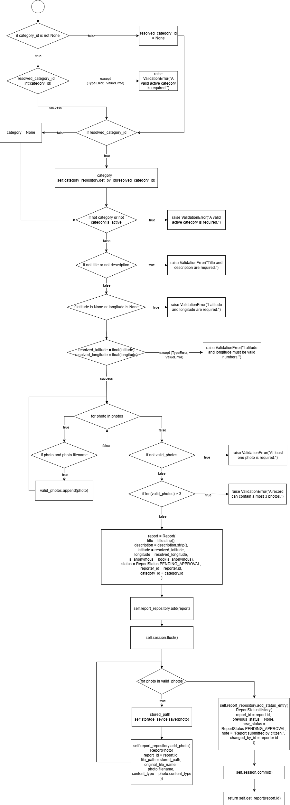
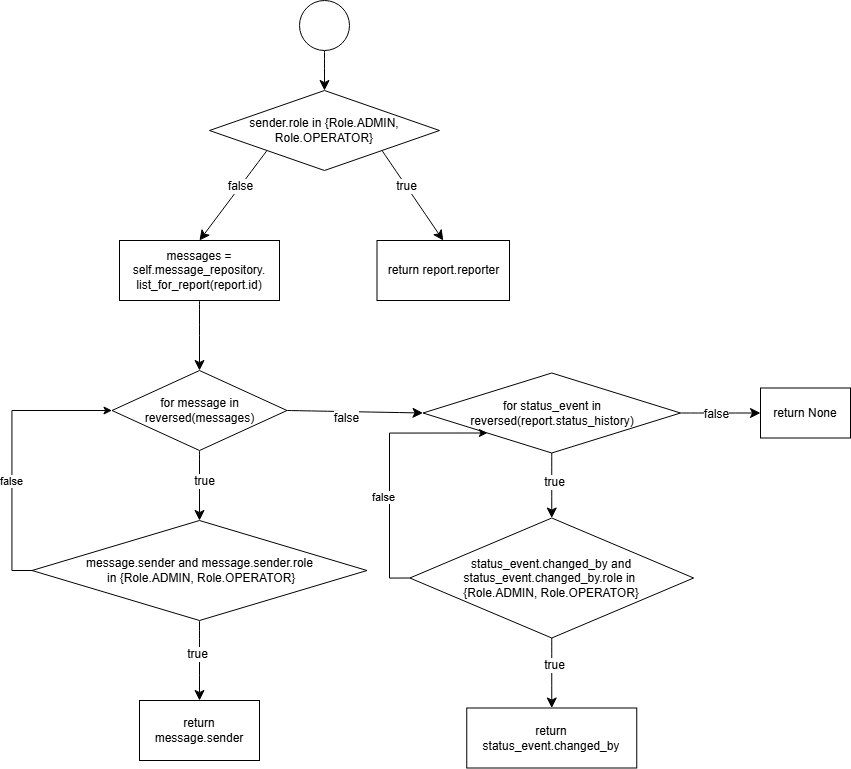
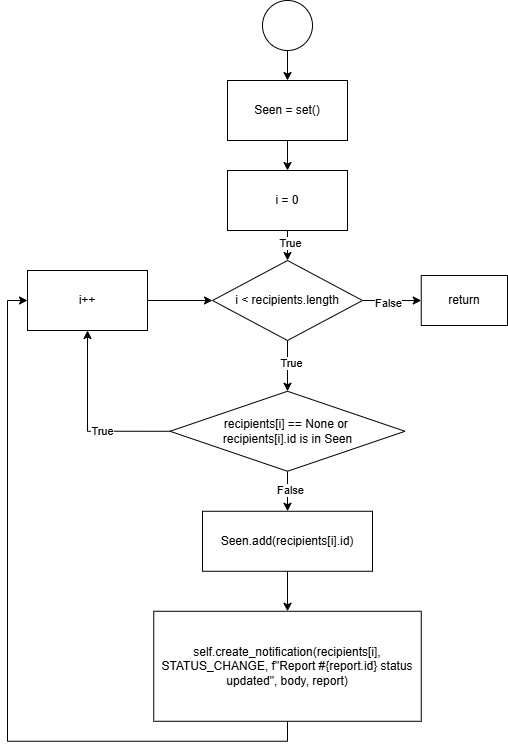
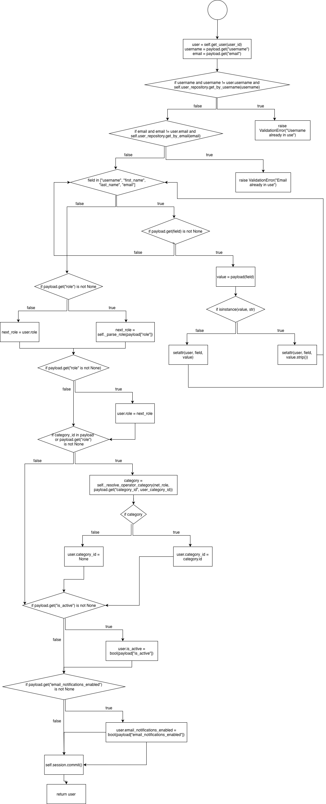

## 1 `ReportService.create_report`

### Control Flow Graph

### Atomic Conditions

- C1: category_id is not None  
- C2: resolved_category_id = int(category_id) raises (TypeError, ValueError)
- C3: resolved_category_id is not None  
- C4: category is None
- C5: categiry.is_active is None  
- C6: title is None
- C7: description is None  
- C8: latitude is None
- C9: longitude is None  
- C10: resolved_latitude = float(latitude) raises (TypeError, ValueError)
- C11: resolved_longitude = float(longitude) raises (TypeError, ValueError)  
- C12: photo in photos
- C13: photo is not None  
- C14: photo.filename is not None
- C15: valid_photos is None
- C16: len(valid_photos) > 3  
- C17: photo in valid_photos

### Structural Lower Bound

The structural lower bound is 13 (12 decision nodes + 1). This indicates that there are 13 linearly independet paths through the control flow graph.

### Node Coverage

To achieve 100% Node Coverage (Statement Coverage), every line of code must be executed. This requires triggering all 7 raise ValidationError blocks through invalid inputs, as well as providing at least one fully valid payload ("Happy Path") to reach the database persistence statements and the final return.

### Edge Coverage

To achieve 100% Edge Coverage (Branch Coverage), we must traverse both the True and False branches of all 12 decision nodes. This includes traversing the "success" and "exception" branches of the try-except blocks, and taking the exit branches of the for loops. A minimum of 8 test cases is mathematically required to cover the 7 failure exits and the 1 successful completion path.

### Condition Coverage

Given the presence of compound boolean expressions (e.g., not category or not category.is_active, not title or not description), Condition Coverage requires evaluating each sub-condition independently. For example, the test suite must include a case where the category is entirely missing (category is None) and another distinct case where the category exists but is inactive (category.is_active is False).

### Loop Coverage

The function contains two loops operating on dynamic lists (the list comprehension for valid_photos and the persistence loop). To satisfy Loop Coverage, we apply the "0, 1, N iterations" strategy:

0 Iterations: Passing an empty list of photos (or photos without filenames) to bypass the persistence loop.

1 Iteration: Passing exactly 1 valid photo.

N Iterations: Passing 2 or 3 valid photos to demonstrate the loop correctly processes multiple elements before exiting.

### Path Coverage

Infeasible. Due to the long, sequential series of independent if statements and try-except blocks, the theoretical number of combined execution paths grows exponentially ($O(2^N)$). Full Path Coverage is practically impossible; therefore, the testing strategy relies on Edge and Condition Coverage.

### Minimal Suite Test

To achieve the maximum feasible structural coverage (100% Edge Coverage), the minimal test suite consists of 8 precisely targeted test cases:

TC-1 (Invalid Category Type): category_id="invalid". Triggers the TypeError/ValueError branch.

TC-2 (Missing Category): category_id=None. Covers the False branch of the ternary operators and fails the not category check.

TC-3 (Missing ttile or description): title="". Fails the not title or not description check.

TC-4 (Missing Coordinates): latitude=None. Fails the is None coordinate check.

TC-5 (Invalid Coordinate Type): latitude="invalid". Triggers the TypeError/ValueError in the float cast.

TC-6 (Zero Valid Photos): photos=[FileStorage(filename=None)]. Bypasses the list comprehension's inner condition, resulting in an empty list and triggering the not valid_photos exception.

TC-7 (Too many Photos): photos=[...] (4 valid photos). Triggers the > 3 limit exception.

TC-8 (Happy Path - N Iterations): A fully valid payload with 2 valid photos. This covers all remaining False branches of the error checks, validates the data casting (int, float, .strip()), and executes the persistence loop multiple times (N iterations).

## 2 `MessagingService._resolve_recipient`

### Control Flow Graph

- 

### Atomic Conditions

- **C1**: `sender.role in {ADMIN, OPERATOR}`
- **C2**: loop condition over `reversed(messages)`
- **C3**: `message.sender is not None`
- **C4**: `message.sender.role in {ADMIN, OPERATOR}`
- **C5**: loop condition over `reversed(report.status_history)` 
- **C6**: `status_event.changed_by is not None`
- **C7**: `status_event.changed_by.role in {ADMIN, OPERATOR}`

### Structural Lower Bound

The structural lower bound is **6**. It is computed from the 5 decision nodes in the control-flow graph, resulting in **6 linearly independent paths**.

### Node Coverage

The test suite must execute every node in the control-flow graph at least once. This includes the initial sender role check, both loop nodes, the internal decision nodes inside the loops, and all return nodes.

In particular, node coverage requires covering the following outcomes:
- direct return of `report.reporter`;
- return of a valid `message.sender`;
- return of a valid `status_event.changed_by`;
- final `return None`.

### Edge Coverage

In order to achieve Edge Coverage, the test suite must cover both true and false branches of every decision node.

### Condition Coverage

The test suite must make each atomic condition evaluate both true and false at least once. Therefore, the following condition outcomes must be covered: 
- C1: true when the sender is ADMIN/OPERATOR, false otherwise;
- C2: true when there is at least one message to inspect, false when the message list is empty or exhausted;
- C3: true when `message.sender` exists, false when it is `None`;
- C4: true when `message.sender.role` is ADMIN/OPERATOR, false otherwise;
- C5: true when there is at least one status event to inspect, false when the status history is empty or exhausted;
- C6: true when `status_event.changed_by` exists, false when it is `None`;
- C7: true when `status_event.changed_by.role` is ADMIN/OPERATOR, false otherwise.

### Loop Coverage

Loop coverage requires executing each loop with:
- 0 iterations,
- 1 iteration, 
- 2 or more iterations.

This function contains two loops:
- the loop over `reversed(messages)`,
- the loop over `reversed(report.status_history)`.

The message loop should be tested at least with an empty message list, a list with one message, and a list with multiple messages.

The status-history loop, instead, should be tested at least with an empty status history, a status history with one event, and a status history with multiple events.

### Path Coverage

Full path coverage is not feasible because the two loops can generate an unbounded number of execution paths. 
For this reason, the goal is to cover the main independent paths through the function:
- sender is ADMIN/OPERATOR and the function returns `report.reporter`;
- sender is not ADMIN/OPERATOR and a valid admin/operator message sender is found;
- sender is not ADMIN/OPERATOR, no valid message sender is found, and a valid admin/operator status changer is found;
- sender is not ADMIN/OPERATOR, no valid message sender is found, no valid status changer is found, and the function returns `None`.

### Minimal Suite Test

A minimal test suite achieving the structural coverage for the function resolve_recipient requires the following **5 test cases**: 

- **TC1 - Sender is ADMIN/OPERATOR**  
  Input: `sender.role = ADMIN` or `sender.role = OPERATOR`  
  Expected result: returns `report.reporter`  

- **TC2 - No messages and no status events**  
  Input: `messages = []`, `report.status_history = []`  
  Expected result: returns `None`  

- **TC3 - Valid message sender found**  
  Input: `messages = [message(sender=admin_user)]`  
  Expected result: returns `message.sender`  

- **TC4 - Valid status changer found**  
  Input: `sender.role = CITIZEN`, `messages = []`, `report.status_history = [status_event(changed_by=operator)]`  
  Expected result: returns `status_event.changed_by`  

- **TC5 - Multiple invalid messages and status events**  
  Input:  
  `messages = [message(sender=None), message(sender=citizen_user)]`  
  `report.status_history = [status_event(changed_by=None), status_event(changed_by=citizen_user)]`  
  Expected result: returns `None`  

Although the structural lower bound is 6, the same execution may cover multiple independent paths. Therefore, the highest feasible structural coverage can be achieved with only 5 non-redundant test cases.

## 3 `NotificationService.notify_status_change`

### Control Flow Graph  
 

### Atomic Conditions
- **C1**: `recipient is None`  
- **C2**: `recipient.id in seen`

### Structural Lower Bound
The structural lower bound is **3**. This value represents the minimum number of independent paths required to cover the loop termination and the two branches of the decision point (the `if` statement).

### Node Coverage
To achieve **100% Node Coverage**, the test suite must ensure that:
- The loop body is entered (**requires a non-empty list**).
- The `continue` statement is executed (**requires a `None` recipient or a duplicate ID**).
- The `seen.add()` and `create_notification()` methods are executed (**requires at least one valid, new recipient**).

### Edge Coverage
All transitions in the CFG must be traversed:
- **Loop Edges**: Traversing the path where the loop condition is **True** (entering the loop) and **False** (empty list or loop completion).
- **Decision Edges**: Traversing the **True branch** of the `if` (triggering `continue`) and the **False branch** (proceeding to notification creation).

### Condition Coverage
Each atomic condition must be evaluated as both **True** and **False**:
- **Test 1**: C1 is **True** (e.g., `recipient = None`) → triggers `continue`.
- **Test 2**: C1 is **False** and C2 is **True** (e.g., a duplicate `user.id`) → triggers `continue`.
- **Test 3**: Both C1 and C2 are **False** (e.g., a new, valid `User`) → triggers notification.

### Loop Coverage
The loop logic is verified through:
- **0 Iterations**: `recipients = []` (the loop is skipped entirely).
- **1 Iteration**: `recipients = [User(id=1)]` (the loop runs once).
- **Multiple Iterations**: `recipients = [User(id=102), User(id=103)]` (ensures the `seen` set persists correctly across iterations).

### Path Coverage
The following logical paths are tested:
- **Path A**: Start → Loop Condition **False** → End.
- **Path B**: Start → Loop Condition **True** → `if` **True** → `continue` → Next Iteration.
- **Path C**: Start → Loop Condition **True** → `if` **False** → `create_notification()` → Next Iteration.

### Minimal Suite Test
A total of **3 test cases** are sufficient to achieve maximum structural coverage:
- **Empty List**: `recipients = []`  
  Covers the 0-iteration loop path and the **False** edge of the loop condition.

- **Null Recipient**: `recipients = [None]`  
  Covers C1 = **True** and the execution of the `continue` node.

- **Duplicate Valid Users**: `recipients = [User(id=102), User(id=102)]`  
  - **Iteration 1**: Covers C1 = **False**, C2 = **False**, and the notification creation node.  
  - **Iteration 2**: Covers C1 = **False**, C2 = **True**, verifying the `seen` set logic and the **True** branch of the `if`.

## 4 `NotificationService.count_unread_message_notifications_by_report`

### Control Flow Graph

### Atomic Conditions
- **C1**: `notification.report_id is None`

### Structural Lower Bound
The structural lower bound is **3**. Three independent paths are required to cover the loop bypass (empty list), the filtering branch (`continue` when None), and the counting branch (dictionary update).
### Node Coverage
A mocked repository must return a list containing at least one notification with a valid `report_id` (to reach the dictionary update) and at least one where `report_id` is `None` (to reach `continue`).
### Edge Coverage
- Loop Entry (True) and Loop Exit (False).

- If branch (True) leading to continue.

- If branch (False) leading to the dictionary update.
### Condition Coverage
- **C1 = True**: notification.report_id is None.

- **C1 = False**: notification.report_id contains a valid integer.
### Loop Coverage
- **0 Iterations**: Repository returns an empty list [].

- **1 Iteration**: List with one valid notification.

- **Multiple Iterations**: List with multiple notifications (including duplicates with the same report_id to test the counts.get(...) + 1 accumulation logic).

### Path Coverage
- **Path A**: Repository returns [] → Loop bypassed → Return {}.

- **Path B**: Loop Condition (True) → if (True) → continue.

- **Path C**: Loop Condition (True) → if (False) → Update dictionary.
### Minimal Suite Test
A total of **2 test cases** are sufficient to achieve maximum structural coverage:

- **Empty List**: `notifications = []`

Covers the 0-iteration loop path and the False edge of the loop condition.

- **Mixed Notifications**: `notifications = [Mock(report_id=None), Mock(report_id=10), Mock(report_id=10)]`

    - **Iteration 1**: Covers **C1 = True** and the execution of the `continue` node.

    - **Iteration 2**: Covers **C1 = False**, the False branch of the `if`, and the dictionary update node (initial insertion).

    - **Iteration 3**: Covers **C1 = False**, verifying the accumulation logic (`counts.get(...) + 1`) for an existing report_id.

## 5 UserService.update_user

### Control Flow Graph

### Atomic Conditions

- C1: username is truthy  
- C2: username != user.username
- C3: self.user_repository.get_by_username(username) is truthy  
- C4: email is truthy
- C5: email != user.email  
- C6: self.user_repository.get_by_email(email) is truty
- C7: field in ["username", "first_name", "last_name", "email"]  
- C8: if payload.get(field) is not None
- C9: isinstance(value, str)  
- C10: payload.get("role") is not None
- C11: category_id in payload  
- C12: category is truthy
- C13: payload.get("is_active") is not None  
- C14: payload.get("email_notifications_enabled") is not None

### Structural Lower Bound

The structural lower bound is 12 (decision nodes + 1). There are 12 linear independent paths in the graph.

### Node Coverage

To achieve 100% Node Coverage (Statement Coverage), every assignment block (including those of the ternary operators) and the two ValidationError exceptions must be executed at least once. This requires test cases that trigger the username and email failures, as well as at least one "Happy Path" test providing a comprehensive payload with valid strings and values to trigger all assignments. 

### Edge Coverage

To achieve 100% Edge Coverage (Branch Coverage), we must traverse both the TRUE and FALSE branches of all 11 decision nodes. This requires tests that trigger the validation blocks and tests that skip or execute the various optional dictionary keys in the payload, as well as varying the data type (string vs. non-string) for the isinstance check.

### Condition Coverage

Given the use of and and or operators in the initial checks (e.g., email validation and the category_id check), Condition Coverage requires varying the sub-conditions individually (e.g., one test with a username equal to the current one, and another with a different username that is not present in the database) to demonstrate the independent evaluation of each atomic condition.

### Loop Coverage

Since the loop iterates over a static, predefined list of 4 strings, testing "0 iterations" is not possible. The loop will always execute exactly 4 iterations for any execution that passes the initial validations. Loop Coverage is intrinsically satisfied.

### Path Coverage

Infeasible. Due to the long sequence of independent if statements following the loop, the theoretical number of combined paths grows exponentially ($O(2^N)$). We will rely on Edge Coverage as the primary acceptance criterion.

### Minimal Suite Test

TC-1 (Username Exception): payload={"username": "already_used_name"}. (Traverses the True branch of the first decision node and terminates).

TC-2 (Email Exception): payload={"email": "already_used@test.com"}. (Traverses the False branch of the 1st node, the True branch of the 2nd node, and terminates).

TC-3 (Maximum Insertion - All True): A comprehensive payload with all fields: payload={"username": "new", "email": "new@test.com", "first_name": "  Luca  ", "role": "OPERATOR", "category_id": 1, "is_active": True, "email_notifications_enabled": False}.
(This covers all "True" branches of the payload.get checks, the True branch of isinstance validating the .strip(), and successfully resolves the category).

TC-4 (Empty Payload - All False): payload={}.
(This bypasses the raise blocks, executes the loop but takes all "False" branches of payload.get, ignoring assignments and leaving the user intact).

TC-5 (Hidden Decision Nodes - Edge Cases): payload={"first_name": 123, "role": "OPERATOR", "category_id": 999}.
(Provides a non-string field to traverse the False branch of isinstance(value, str) bypassing the .strip(), and provides a non-existent ID so the category variable is None, covering the False branch of the related ternary operator).

